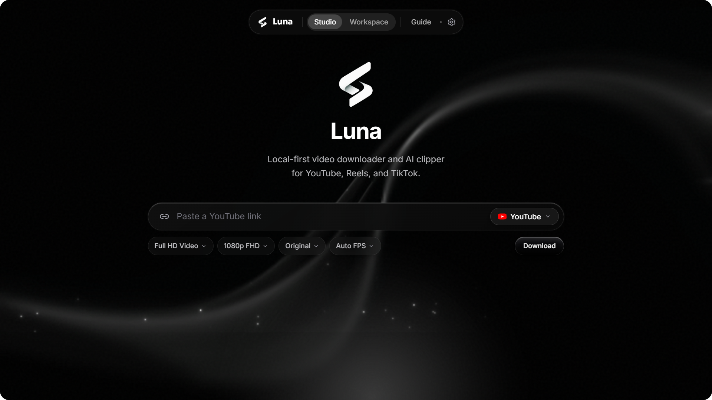
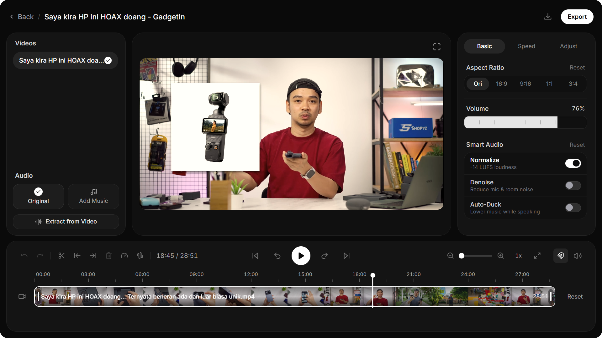
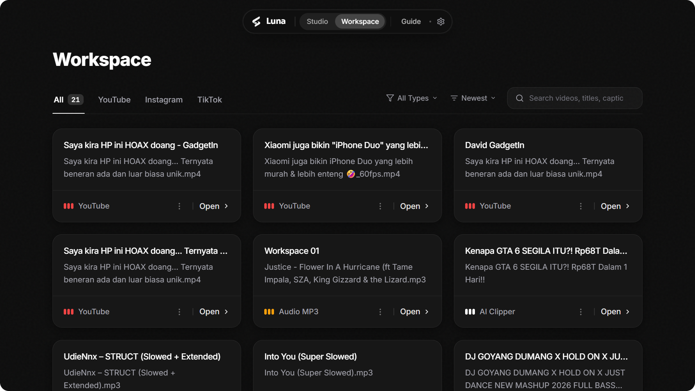
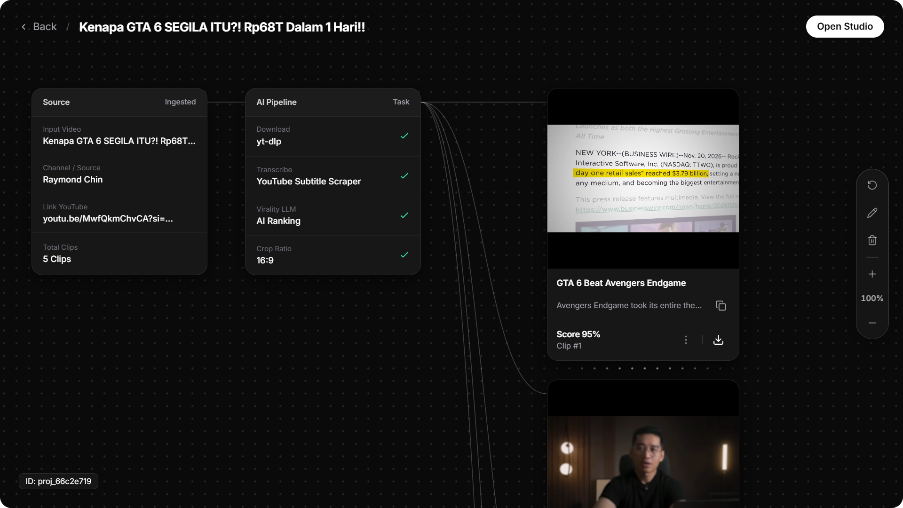

<p align="center">
  <picture>
    <source media="(prefers-color-scheme: dark)" srcset="luna/assets/dark-banner.png">
    <source media="(prefers-color-scheme: light)" srcset="luna/assets/light-banner.png">
    
  </picture>
</p>
<div align="center">

### Local-First Video Downloader & AI Clipper

---

[Install](#install) · [Update](#update) · [Features](#features) · [Roadmap](ROADMAP.md) · [MCP](MCP.md) · [Docker](#docker) · [FAQ](#faq)

[](.python-version)
[](requirements.txt)
[](#requirements)
[](LICENSE)

</div>

---

**Luna** is a local web app for downloading video and audio from YouTube, Instagram, and TikTok, organizing files in Workspace, and turning long videos into short clips with AI. Downloads need no API keys and run straight on your machine. For AI Short Clips, Luna uses YouTube captions first (or transcribes audio via Groq Whisper, Gemini, ElevenLabs Scribe, or local Faster-Whisper), ranks highlights with Gemini or any OpenAI-compatible model, and renders vertical or widescreen clips locally with FFmpeg.

<p align="center">
  
</p>

<br />

<details>
<summary><strong>Click here to see more previews</strong></summary>

<br />

### Full Video Studio

Edit downloaded videos on a multi-block timeline with Auto Cut Silence, 2D Speed Curve, aspect ratio reframing, color looks, Smart Audio, and multi-layer music.

<p align="center">
  
</p>

<br />

### Workspace

Browse your local library by platform or mode, search titles and captions, and keep YouTube, Audio MP3, Video Trimmer, and AI Short Clips in separate workspaces.

<p align="center">
  
</p>

<br />

### AI Clipper Canvas

Review source video metadata, AI pipeline steps, and virality-ranked clip cards on one canvas, then download clips in bulk or open any clip directly in Studio.

<p align="center">
  
</p>

</details>

## Install

Git is not needed for the quick installers. Both put Luna in `%USERPROFILE%\Luna` on Windows (`~/Luna` on macOS and Linux), set up [uv](https://docs.astral.sh/uv/), Python 3.12, dependencies, FFmpeg if missing, and a default `.env`, then open Luna at [http://localhost:8000](http://localhost:8000). Nothing is installed system-wide except `uv`.

### Windows PowerShell (recommended)

```powershell
irm https://raw.githubusercontent.com/miqdadbadjuber/luna/main/install.ps1 | iex
```

This adds a Luna shortcut to the Desktop and Start Menu. Start Luna later by double-clicking that shortcut with no terminal needed.

### macOS and Linux

```bash
curl -fsSL https://raw.githubusercontent.com/miqdadbadjuber/luna/main/install.sh | sh
```

Start Luna again later with `./start.sh`.

### From a Git clone

If you cloned the repository, run the local installer once inside the clone folder.

On Windows PowerShell (PowerShell blocks `.ps1` files by default):

```powershell
powershell -ExecutionPolicy Bypass -File .\install.ps1
```

| You see | What to do |
| --- | --- |
| `start.bat` is not recognized | PowerShell does not run files from the current folder. Type `.\start.bat`, or double-click the file. |
| `Luna is not installed yet. Run install.ps1 first.` | This folder has no `.venv` yet. Run the install command above in the same folder. |
| `running scripts is disabled on this system` | Use the `powershell -ExecutionPolicy Bypass -File .\install.ps1` form. |

On macOS and Linux:

```bash
./install.sh
```

### Manual install

Create a Python 3.12+ virtual environment, install FFmpeg and FFprobe, then run:

```bash
pip install -r requirements.txt
cp .env.example .env
python -m luna
```

`npm run dev` and `npm start` in `package.json` only wrap those Python commands. Node is optional, not a required toolchain.

### Docker

Docker replaces the local Python and FFmpeg install. Create these host files first so Compose does not create root-owned directories:

```bash
cp .env.example .env
touch cookies.txt
mkdir -p output media-vault
```

On Linux, also export your host user IDs so the container can write to them:

```bash
export LUNA_UID=$(id -u) LUNA_GID=$(id -g)
```

Then start Luna:

```bash
docker compose up -d --build                                  # production mode
docker compose -f compose.yaml -f compose.dev.yaml up --build # development, reloads on save
```

Inside a container, the Settings folder picker and Open Folder button cannot reach your desktop. Open `media-vault/` on the host instead, because Compose fixes `MEDIA_STORAGE_DIR` to the mounted volume.

## Update

Open **Settings > Check for Updates** to update directly inside Luna. It works for both Git clones and archive installs, installs updated dependencies when `requirements.txt` changes, restarts the server in place in the same terminal, and keeps your `.env`, `cookies.txt`, and media untouched.

You can also update from a terminal by re-running the install command above, or running `git pull` followed by `install.ps1` or `./install.sh` when dependencies change.

## Features

| Feature | API keys | What it does |
| --- | --- | --- |
| Video & MP3 download | None | Downloads video or 320 kbps MP3 from YouTube, TikTok, and Instagram |
| AI Short Clips | Gemini (or OpenAI-compatible) + Groq (or Gemini, ElevenLabs) | Picks viral moments and renders 9:16, 1:1, 3:4, or 16:9 clips with optional face tracking |
| Full Video Studio | None | Non-destructive NLE for downloaded videos: multi-block timeline cuts, Auto Cut Silence, 2D Speed Curve, reframing, 6 Looks + Adjust, Smart Audio, multi-layer audio, and GPU-accelerated export |
| AI Clipper Studio | None | Edits AI-generated clips locally with Selene subtitles, inline transcript editing, background music, and non-destructive MP4 export |
| Manual Video Trimmer | None | Cuts exact timestamp ranges without AI |
| Workspace | None | Organizes, previews, renames, and manages local downloads and clips |
| Local Whisper transcription | None for transcription | Install `requirements-whisper.txt` and set `LOCAL_TRANSCRIBE_PROVIDER=whisper` |
| Cookies for restricted videos | None | Optional upload in Settings for age- or login-gated sources (`cookies.txt`) |

API keys are required for AI Short Clips only. Add your keys in Settings with no file to edit; only the audio or transcript needed for clipping is sent to your chosen provider, and you should never commit `.env` or `cookies.txt`.

## AI agents (MCP)

`luna/mcp_server.py` lets an MCP client such as Claude Code start clip jobs, follow progress, and collect the rendered clips. Install `requirements-mcp.txt`, then register it:

```bash
claude mcp add luna -e LUNA_URL=http://127.0.0.1:8000 -- /path/to/luna/.venv/bin/python /path/to/luna/luna/mcp_server.py
```

See [MCP.md](MCP.md) for the tools, running Luna on another machine, and a simulated session.

## Development & tests

```text
luna/            web app: API, storage, Workspace, templates, assets
luna/clipper/    clip pipeline, under its own MIT license
tests/           unittest suite
```

Python code reloads on save with `python -m luna`, and `luna/templates/*.html` is read on every request. Set `MEDIA_STORAGE_DIR=media-vault` in `.env` to keep test downloads separate from your real library. `.python-version` pins CI to Python `3.12`.

```bash
pip install -r requirements-dev.txt
python -m unittest discover -v
```

## Production & security

Luna has no built-in authentication, and its API can read settings, update API keys, and move files. Keep it on `127.0.0.1`, or put an authenticating reverse proxy in front of it and add the proxy hostname to `LUNA_ALLOWED_HOSTS` in `.env`. Run a single process, because job state is held in memory.

Without Docker, launch with `.\start.bat`, `./start.sh`, or `npm start`. With Docker, pushing a `v*` tag publishes `ghcr.io/miqdadbadjuber/luna` (amd64 only); run it with `LUNA_IMAGE=ghcr.io/miqdadbadjuber/luna:<tag> docker compose up -d --no-build` after creating the host mounts above.

## FAQ

**Do I need API keys to download videos?**
No. Video downloads, 320 kbps MP3 extraction, and Manual Video Trimmer work with zero API keys.

**Which AI providers are supported?**
Fresh setups default to Gemini for clip analysis and Groq Whisper for audio transcription. You can switch clip analysis to any OpenAI-compatible endpoint, and transcription to Gemini, ElevenLabs Scribe, or local Faster-Whisper, in Settings at any time.

**Where are my files stored?**
Temporary downloads go to `output/`. Workspace uses `MEDIA_STORAGE_DIR` when set, defaulting to `D:\Luna-Media` on Windows and `output/` on macOS and Linux.

**What if port 8000 is already in use?**
Luna picks the next free port and prints it. Set `LUNA_PORT` if you want to pin a specific port.

**What about cookies and copyright?**
Cookies are optional and sensitive, so never share or commit `cookies.txt`. Platform changes can affect `yt-dlp`, and you are responsible for having the rights to any videos you download, cut, and publish.

## Maintainers

Luna is built and maintained by:

<div align="center">
  <table align="center">
    <tr>
      <td align="center">
        <a href="https://github.com/miqdadbadjuber">
          <br />
          <sub><b>Miqdad Badjuber</b></sub>
        </a><br />
        <sub><code>@miqdadbadjuber</code></sub>
      </td>
      <td align="center">
        <a href="https://github.com/fajarhide">
          <br />
          <sub><b>Fajar Hidayat</b></sub>
        </a><br />
        <sub><code>@fajarhide</code></sub>
      </td>
    </tr>
  </table>
</div>

Want to contribute? Open an [issue](https://github.com/miqdadbadjuber/luna/issues) for bugs or ideas, or read [CONTRIBUTING.md](CONTRIBUTING.md) before sending a pull request.

## License

Luna is licensed under [AGPL-3.0-or-later](LICENSE). Copyright (C) 2026 Miqdad Badjuber. You may run, modify, and distribute it, provided you share source under the same license and keep copyright and license notices intact.

`luna/clipper/` keeps its upstream MIT License at [`luna/clipper/LICENSE`](luna/clipper/LICENSE); see [THIRD_PARTY_NOTICES.md](THIRD_PARTY_NOTICES.md) for full attribution. Commercial licensing without AGPL terms is available on request through the repository issue tracker.
